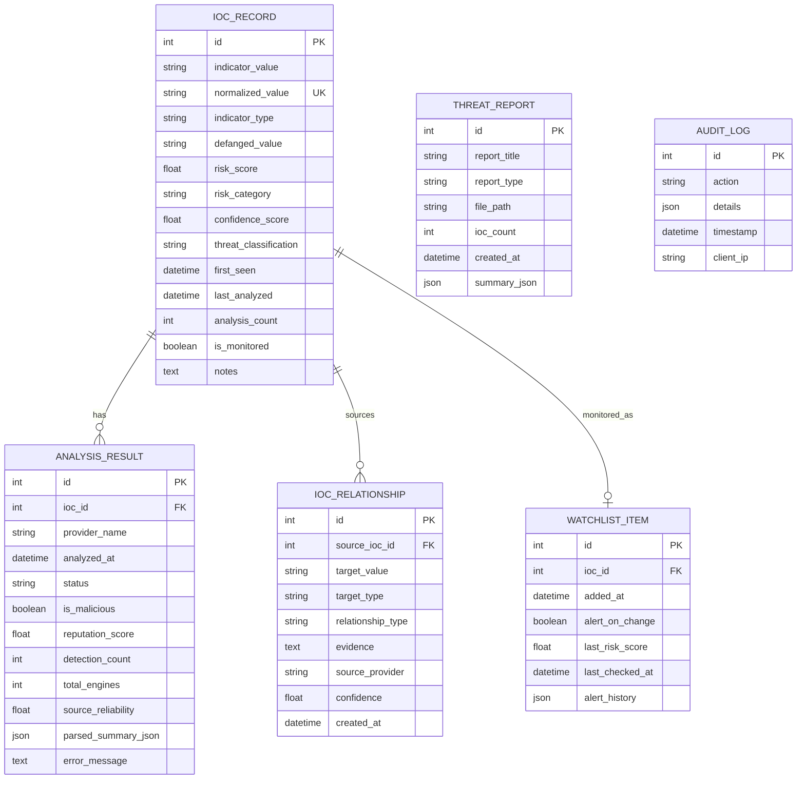

# Architecture and System Design Documentation

**Cyber Threat Intelligence (CTI) Analysis Platform**  
*Enterprise Multi-Source Indicator Analysis, Heuristic Scoring, and Correlation Engine*

---

## 1. High-Level Architecture

The platform is designed around a modular, decoupled architecture consisting of an asynchronous REST API backend (FastAPI), an interactive cybersecurity operations dashboard (Streamlit + Plotly), a persistent data layer (SQLAlchemy + SQLite/PostgreSQL), and specialized intelligence engines.

```mermaid
flowchart TD
    subgraph UI ["Client & Presentation Layer"]
        A[Security Analyst] -->|Browser / Interactive UI| B[Streamlit Dashboard (Port 8501)]
        A -->|REST API / SIEM Webhooks| C[FastAPI REST Engine (Port 8000)]
    end

    subgraph Core ["IOC Core Pipeline"]
        B & C --> D[IOC Validator & Sanitizer]
        D -->|Defang / Refang / RFC Check| E[Security & SSRF Filter]
        E -->|Safe Target Verified| F[Unified Intelligence Dispatcher]
    end

    subgraph Engines ["Specialized Threat Engines"]
        F --> G[IP Engine]
        F --> H[Domain Engine]
        F --> I[URL Engine]
        F --> J[File Hash Engine]
    end

    subgraph Providers ["Multi-Source Intelligence Providers"]
        G & H & I & J --> K[Local Baseline KnowledgeBase]
        G & H & I & J --> L[VirusTotal v3 Adapter]
        G & H & I & J --> M[AbuseIPDB v2 Adapter]
        G & H & I & J --> N[URLhaus abuse.ch Adapter]
        G & H & I & J --> O[AlienVault OTX Adapter]
    end

    subgraph Analysis ["AI, Risk Scoring & Correlation"]
        K & L & M & N & O --> P[AI/ML Heuristic Models]
        P -->|DGA / Phishing / Anomaly| Q[Explainable Risk & Confidence Scorer]
        Q --> R[NetworkX Correlation Engine]
    end

    subgraph Persistence ["Persistence & Export Layer"]
        R --> S[(SQLAlchemy Database)]
        R --> T[ReportLab PDF / JSON / CSV Generators]
    end
```

---

## 2. Component Breakdown

### A. Core Validation & Security Layer (`app/core/`)
- **`validator.py`**: Enforces strict RFC compliance for IPv4, IPv6, Domain names, and URLs. Normalizes hashes (MD5, SHA-1, SHA-256). Provides automatic bidirectional defanging (`hxxp[s]://` ⇄ `http[s]://`, `[.]` ⇄ `.`).
- **`security.py`**: Enforces strict Server-Side Request Forgery (SSRF) protection. Disallows requests to RFC 1918 (10.0.0.0/8, 172.16.0.0/12, 192.168.0.0/16), loopback (`127.0.0.0/8`, `::1`), link-local (`169.254.0.0/16`), and carrier-grade NAT. Resolves hostnames prior to connection to defend against DNS rebinding.
- **`rate_limiter.py`**: Implements a sliding-window token bucket algorithm per threat intelligence provider, preventing quota exhaustion, coupled with a thread-safe in-memory TTL cache (default 3600s).

### B. Provider Adapter Layer (`app/providers/`)
All external and internal feeds inherit from `BaseThreatProvider`:
- **`LocalThreatIntelProvider`**: Queries curated baseline signatures, executes live DNS queries (A, AAAA, MX, NS, TXT, CNAME) via `dnspython`, and queries WHOIS/RDAP without requiring external keys.
- **`VirusTotalProvider`**: VirusTotal v3 API adapter for IPs, domains, URLs, and file hashes.
- **`AbuseIPDBProvider`**: AbuseIPDB v2 adapter for IP abuse reports and confidence scoring.
- **`URLhausProvider`**: Abuse.ch URLhaus adapter for malicious payload URLs and hashes.
- **`AlienVaultOTXProvider`**: AlienVault Open Threat Exchange adapter for threat pulses and campaign tags.

### C. Analytical & AI Layer (`app/engines/`)
- **`risk_scorer.py`**: Computes an explainable Risk Score (0–100) and a separate Confidence Score (0–100). Implements structured point tracking so analysts can view every single contributing evidence factor.
- **`ai_engine.py`**:
  - *DGA Classifier*: Evaluates Shannon entropy, consonant clusters, and vowel-to-consonant ratios to detect synthetic botnet domains.
  - *Phishing Classifier*: Evaluates lexical URL structures, path sensitivity, brand impersonation, and obfuscation.
  - *Anomaly Detection*: Evaluates Levenshtein distance against known target brands (typosquatting).
  - *Narrative Summarizer*: Generates analyst-ready executive briefs and tactical action plans.
- **`correlation.py`**: Employs `networkx.DiGraph` to build directional relationship networks connecting IPs, domains, URLs, hashes, campaigns, and malware families with verifiable evidence citations.

### D. Reporting Layer (`app/reports/`)
- **`pdf_generator.py`**: Generates publication-ready PDF assessment dossiers using ReportLab, styled with cybersecurity color palettes, risk badges, evidence matrices, and defensive recommendations.
- **`json_generator.py`**: Produces machine-readable JSON reports.
- **`csv_generator.py`**: Generates RFC-4180 CSV export sheets for SIEM and ticketing ingestion.

---

## 3. Database Entity-Relationship Schema



---

## 4. Explainable Risk Scoring Methodology

The platform strictly adheres to the principle that **a missing detection is never proof of safety**.

### Mathematical Model
$$\text{RiskScore} = \min\left(100, (S_{\text{rep}} \cdot W_{\text{rep}}) + (S_{\text{heur}} \cdot W_{\text{heur}}) + (S_{\text{comm}} \cdot W_{\text{comm}}) + (S_{\text{ai}} \cdot W_{\text{ai}})\right)$$

| Component | Default Weight | Description |
|---|---|---|
| **Reputation ($W_{\text{rep}}$)** | **0.35** | Commercial provider verified detections (VirusTotal, URLhaus) |
| **Heuristics ($W_{\text{heur}}$)** | **0.25** | Structural anomalies, protocol flags, NXDOMAIN, high-risk extensions |
| **Community ($W_{\text{comm}}$)** | **0.25** | Community threat pulses (AlienVault OTX, AbuseIPDB reports) |
| **AI/ML ($W_{\text{ai}}$)** | **0.15** | Synthetic DGA classifiers and lexical phishing prediction models |

### Categorization Tiers
- **CRITICAL (90–100):** Confirmed active malware, ransomware, or active C2 beacon. Immediate containment required.
- **HIGH (70–89):** High probability of malicious intent; multiple corroborated threat detections.
- **MEDIUM (30–69):** Suspicious infrastructure, anonymization proxies (Tor/VPN), high-entropy domains.
- **LOW (0–29):** Clean traffic, baseline infrastructure, or authorized benign scanners.

### Confidence Score (0–100)
Calculated independently from Risk Score based on:
1. Coverage of active external and local data sources ($+15\%$ per verified provider).
2. Corroborating consensus between independent feeds ($+20\%$ bonus if $2+$ providers agree).
3. Structural protocol completeness ($+10\%$ for valid DNS/HTTP headers).
